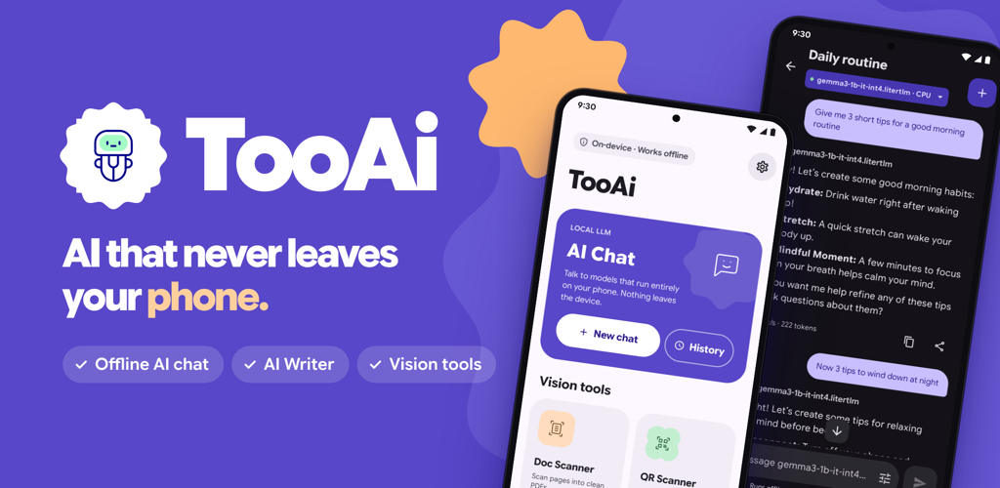
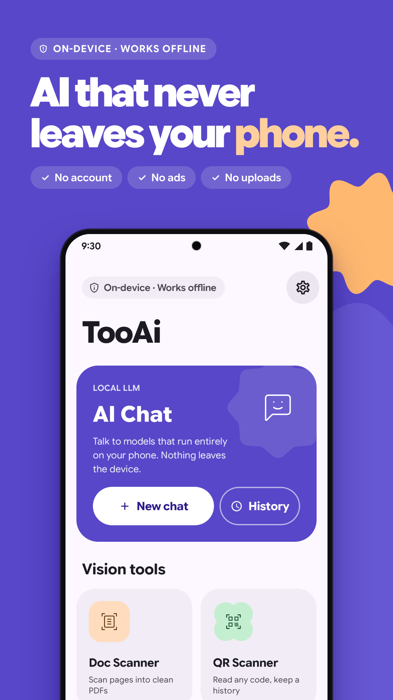
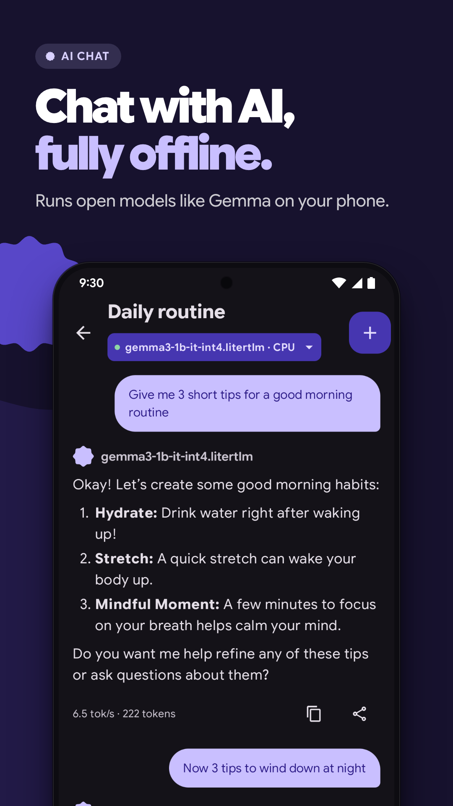
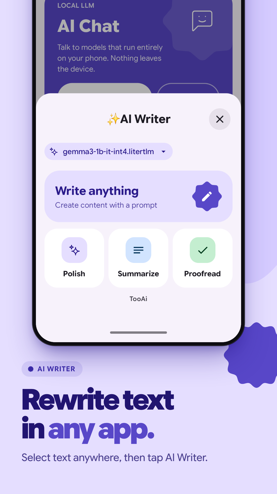
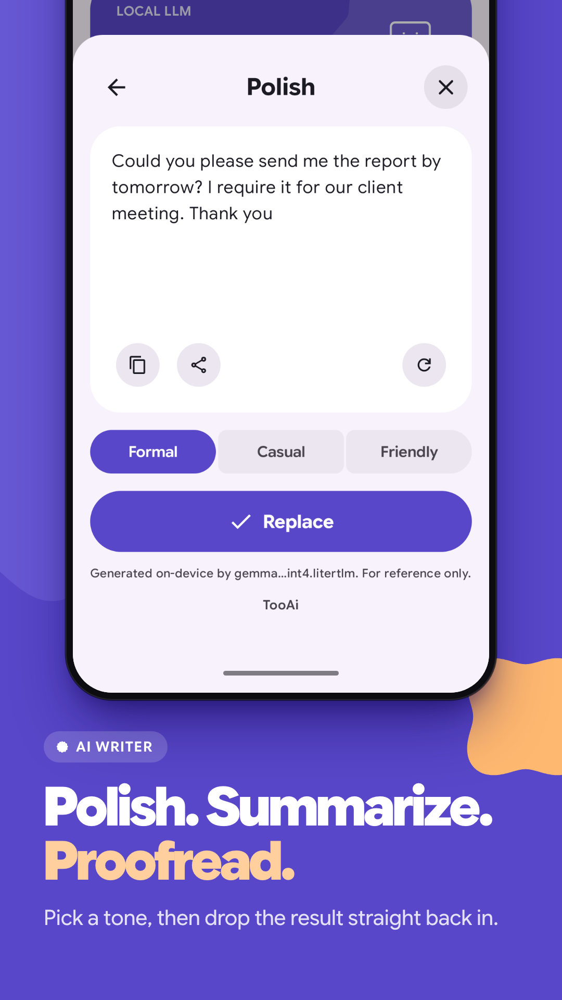
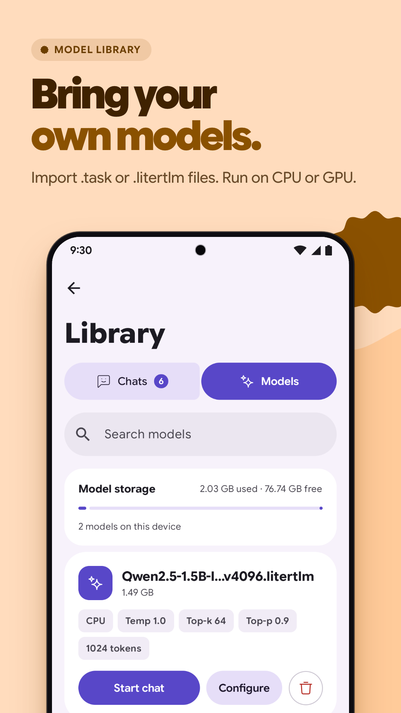
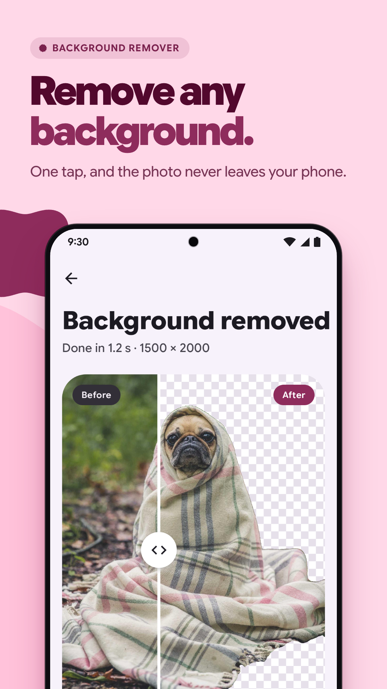
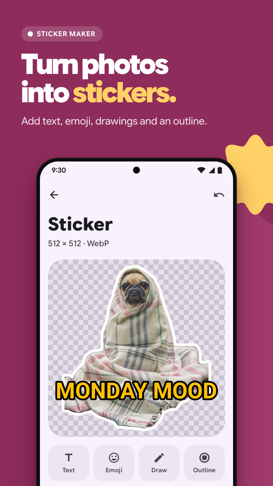
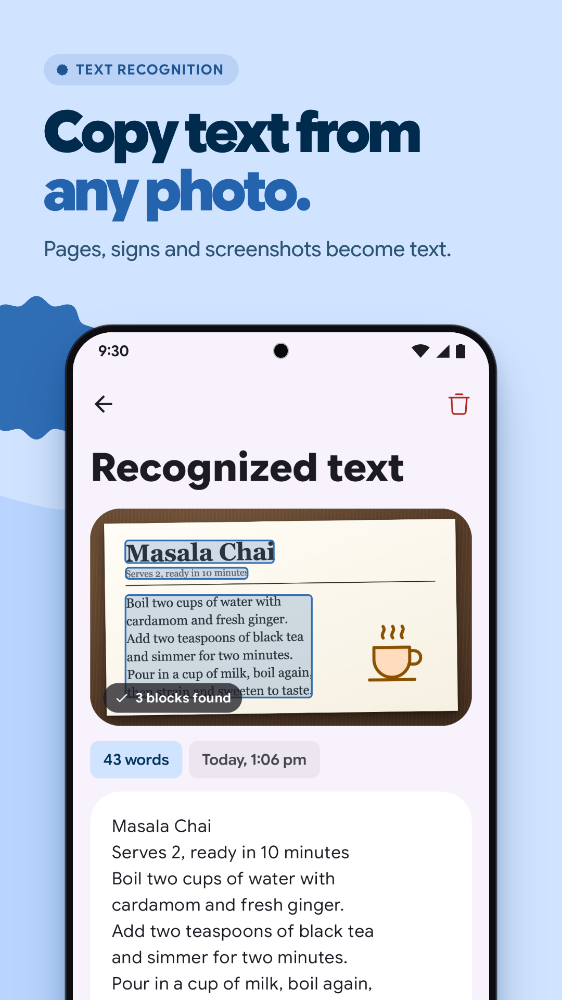

# TooAi

**AI that never leaves your phone.** TooAi is an offline-first Android toolkit: chat with a language
model running on your own device, rewrite text in any app, and scan, read and cut out images with
on-device machine learning.

There is no account, no ads and no analytics, and nothing you type or scan is uploaded to a server.

[](https://github.com/Rajkumarbhakta/TooAi/releases/latest)

[](LICENSE)

**[Download the latest APK](https://github.com/Rajkumarbhakta/TooAi/releases/latest)**

<p align="center">
  
  
  
  
</p>
<p align="center">
  
  
  
  
</p>

# Features

### AI Chat, fully offline

Import a model file and chat with it entirely on the device. TooAi runs on LiteRT-LM, so small open
models such as Gemma 3 and Qwen2.5 answer straight from the phone, even in airplane mode.

- Markdown replies with lists, headings and code
- Switch models mid-conversation; each reply keeps the name of the model that wrote it
- Long chats stay coherent: older turns are carried into a fresh context by token budget
- Search, rename or export chats as text

### AI Writer: rewrite text in any app

Select text in any app (email, chat, notes, browser), tap **AI Writer** in the selection menu, and
rewrite it on the spot.

| Page      | Options                                         |
|-----------|-------------------------------------------------|
| Polish    | Formal · Casual · Friendly                      |
| Summarize | Bullet points · Short paragraph · Concise       |
| Proofread | Grammar · Clarity · Concise                     |
| Prompt    | Free-form instruction, selection as context     |

Regenerate or change the tone to get another version and flip between them. When the host app allows
editing, **Replace** writes the result straight back into the field. The share sheet works as a
read-only fallback.

### Bring your own models

- Import any `.task` or `.litertlm` file
- Run each model on CPU or GPU, with an automatic fallback to CPU if the GPU path fails
- Tune max tokens, temperature, Top-K and Top-P per model

### Background remover

Pick or take a photo and TooAi cuts out the subject in a tap. Compare with the before/after slider,
put it on a transparent, white, pink or blue backdrop, then save as PNG or share. No watermark.

### Sticker maker

Turn any cut-out into a sticker: add captions and emoji, wrap it in an outline, and undo any step.
Copy, share or save it as a 512 × 512 WebP under 100 KB.

### Text recognition

Pull the text out of any photo or screenshot with on-device OCR, then copy or share it in one tap.
Past results stay in a searchable history.

### Document scanner

Scan documents and receipts with automatic edge detection, or import pages from the gallery. Every
scan is saved as a shareable PDF.

### QR & barcode scanner

Scan QR codes and barcodes and keep a local, searchable history of links, Wi-Fi codes, contacts and
product codes.

### Built for privacy

- Every AI feature runs on the device
- No sign-up, no ads, no analytics, no in-app purchases
- No camera or storage permission: photos come from the system camera and Android's photo picker
- Chats, scans and history stay in a local database

### Material 3 Expressive

Light, dark or system theme, with an Indigo, Teal, Amber or Rose accent, or Material You colours
from the wallpaper on Android 12+.

# Requirements

- Android 8.0 (API 26) or newer for the scanners, text recognition, background remover and stickers
- Android 12 (API 31) or newer for AI Chat and the AI Writer
- A `.task` or `.litertlm` model file, imported from **Models → Import Model**

Models are not bundled with the app, so the download stays small. Bigger models need more RAM:
1B-parameter models such as Gemma 3 1B suit most phones, while a 1.5B model can be killed for low
memory on a phone with under 4 GB.

The scanner, barcode and background-remover features use Google Play Services on-device ML modules,
which are fetched once and then run offline.

### AI Writer on Samsung

The selection-menu entry appears once the app has been launched at least once after install. On
Samsung One UI it is also gated behind an opt-in list in **Settings → General management → TooAi**;
on stock Android it appears automatically.

# Getting started

```sh
./gradlew :app:assembleDebug
adb install -r app/build/outputs/apk/debug/app-debug.apk
```

Run the unit tests with:

```sh
./gradlew testDebugUnitTest
```

To exercise the AI Writer without a host app, send it a `PROCESS_TEXT` intent directly:

```sh
adb shell "am start -a android.intent.action.PROCESS_TEXT -t text/plain \
  --es android.intent.extra.PROCESS_TEXT 'we should of went their yesterday' \
  --ez android.intent.extra.PROCESS_TEXT_READONLY false \
  -n com.rkbapps.tooai/.activity.AiWriterActivity"
```

Every push to `master` with a new `versionName` builds a signed APK and publishes it as a GitHub
Release.

# Tech stack

- [Kotlin](https://kotlinlang.org/) with [Coroutines](https://kotlinlang.org/docs/coroutines-overview.html)
  and [Flow](https://kotlinlang.org/docs/flow.html)
- [Jetpack Compose](https://developer.android.com/jetpack/compose) with
  [Material 3 Expressive](https://m3.material.io/blog/building-with-m3-expressive)
- [Navigation 3](https://developer.android.com/guide/navigation/navigation-3): back-stack driven
  navigation for Compose
- [ViewModel](https://developer.android.com/topic/libraries/architecture/viewmodel),
  [Room](https://developer.android.com/training/data-storage/room) and
  [DataStore](https://developer.android.com/topic/libraries/architecture/datastore)
- [Hilt](https://developer.android.com/training/dependency-injection/hilt-android) for dependency
  injection
- [LiteRT-LM](https://ai.google.dev/edge/litert): on-device LLM runtime behind AI Chat and the AI
  Writer, on CPU or GPU
- [ML Kit](https://developers.google.com/ml-kit): document scanning, barcode scanning, text
  recognition and subject segmentation
- [Coil](https://coil-kt.github.io/coil/) for image loading
- [compose-richtext](https://github.com/halilozercan/compose-richtext) for Markdown in chat replies

# Architecture

- MVVM with Compose state, repository pattern, single module `:app`, package `com.rkbapps.tooai`
- Two activities: `MainActivity` for the app, and a translucent `AiWriterActivity` for the
  system-wide text actions
- AI Chat and the AI Writer have separate repositories. The writer never touches the chat database,
  so rewriting text from another app can't create chat sessions
- The sticker editor keeps one immutable document and one renderer, so the exported sticker is
  exactly what was on screen
- Room database `app_database` holds QR scans, recognised text, document scans, imported models,
  chat sessions and chat messages

# License

Released under the MIT License. See [LICENSE](LICENSE) for the full text.

```
MIT License

Copyright (c) 2024 Rajkumar Bhakta
```
